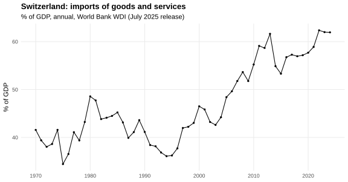
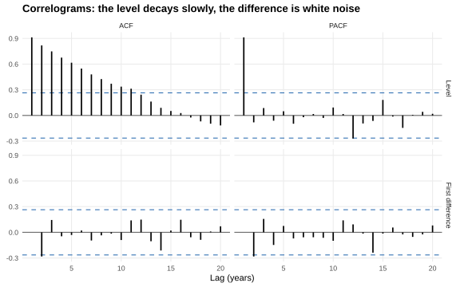
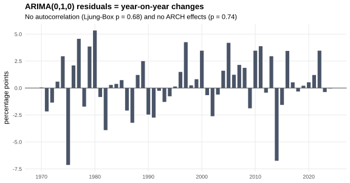
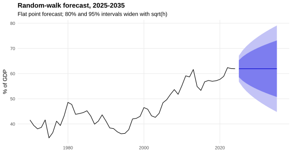
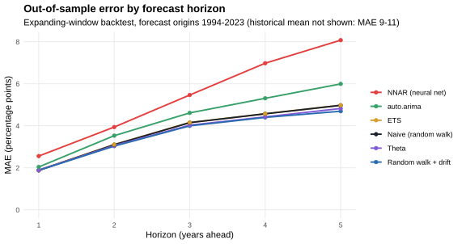
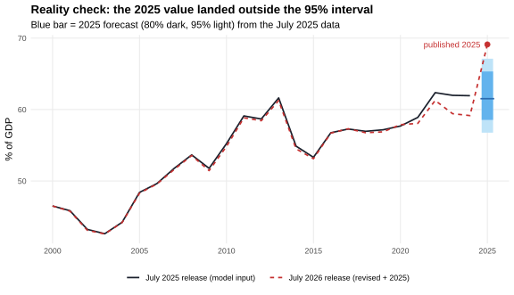

# Forecasting Switzerland's import share of GDP in R

**ARIMA modelling, rolling-origin backtesting against six alternatives (including a neural network), and a check of the forecast against data published a year later.**


The series is Switzerland's imports of goods and services as a share of GDP, annual from 1970 to 2024 (World Bank WDI). I first built a model with the classical Box-Jenkins workflow. Then I checked whether that model would really have forecast well. Finally I compared its 2025 forecast with the value the World Bank published in 2026.

## Key findings

| | Result |
|---|---|
| **Model** | The series has a unit root. Its yearly changes are white noise, so the best model is a **random walk, ARIMA(0,1,0)**. AIC, BIC and `auto.arima` all choose it, and the residuals pass the autocorrelation, ARCH and normality tests. |
| **Backtest** | I scored 980 out-of-sample forecasts (forecast origins 1994-2023, 1-5 years ahead). The random walk is within 4% of the best model. Its 80% and 95% intervals cover 81% and 98% of outcomes, so they are honest. |
| **More complex ≠ better** | `auto.arima`, refit at each origin, was **15% worse** than the plain random walk. The neural network (NNAR) was **44% worse**. The reason: on short samples the unit-root decision goes wrong (see below). |
| **Reality check** | The published 2025 value is **69.1%**. The 95% interval was [56.8, 67.1], so the actual value is outside it. The 2024→2025 change of +10 pp is the largest in 56 years. In the same release, the World Bank revised 2023-2024 down by ~2.7 pp. |

## Skills shown

- **R**: modular scripts, reproducible with one command. They use `forecast`, `tseries` and `ggplot2`, plus an ARCH LM test written from its definition.
- **Statistical inference**: ADF and KPSS unit-root tests, Ljung-Box, ARCH LM, Shapiro-Wilk, and the Diebold-Mariano test for forecast comparison.
- **Model selection and validation**: information criteria (AIC/AICc/BIC) for in-sample fit, and **time-series cross-validation** for out-of-sample skill with no look-ahead leakage.
- **ML baseline**: a neural network autoregression (`nnetar`) evaluated under the same conditions as the statistical models.
- **Analytical judgement**: finding out *why* a model wins or loses, calibrating prediction intervals, and dealing with data revisions and structural shocks.

---

## 1. Box-Jenkins analysis (`R/01_box_jenkins.R`)



The import share moves between 34% and 49% until the mid-1990s. After that it rises to about 62%, with sharp falls in 1975, 2009 and 2014.

### Stationarity

| Test | Series | Statistic | p-value | Conclusion |
|---|---|---|---|---|
| Ljung-Box (10 lags) | level | χ² = 237.3 | < 0.001 | strong autocorrelation |
| ADF | level | −1.83 | 0.643 | unit root not rejected |
| ADF | 1st difference | −4.01 | 0.016 | stationary → **d = 1** |
| Ljung-Box (5 / 10 / 15 lags) | 1st difference | 6.1 / 7.3 / 14.5 | 0.30 / 0.69 / 0.49 | white noise |

The KPSS-based `ndiffs()` also gives d = 1.



The level ACF decays slowly and its PACF has one large spike: this is the signature of a random walk. After differencing, no lag is clearly outside the 95% band. Lag 2 touches the band, and the Ljung-Box tests above show that this is not significant as a whole.

### Candidate models

| Model | Parameters | AIC | AICc | BIC |
|---|---|---|---|---|
| **ARIMA(0,1,0)** | 1 | **260.19** | **260.26** | **262.17** |
| ARIMA(0,1,1) | 2 | 262.13 | 262.36 | 266.11 |
| ARIMA(1,1,0) | 2 | 262.16 | 262.39 | 266.14 |
| ARIMA(1,1,1) | 3 | 263.96 | 264.44 | 269.92 |

In the richer models, the extra coefficients are close to zero: AR(1) = 0.023 (s.e. 0.136) and MA(1) = 0.048 (s.e. 0.201). They only add complexity. `auto.arima()` chooses the same ARIMA(0,1,0).

The final model is

$$Y_t = Y_{t-1} + \varepsilon_t, \qquad \varepsilon_t \sim \text{WN}(0,\ \sigma^2 = 6.98)$$

This means: next year's import share is this year's value plus an unpredictable shock with a standard deviation of about 2.6 pp. A drift term (0.38 pp/year, s.e. 0.36) is not significant and increases BIC.

### Diagnostics



| Test on residuals | Statistic | p-value |
|---|---|---|
| Ljung-Box (10 lags) | χ² = 7.49 | 0.678 |
| ARCH LM (10 lags) | χ² = 6.90 | 0.735 |
| Shapiro-Wilk | W = 0.969 | 0.158 |

There is no remaining autocorrelation, no volatility clustering and no evidence against normality. Thus, the Gaussian prediction intervals are justified.

### Forecast 2025-2035



| Year | Point | 80% interval | 95% interval |
|---|---|---|---|
| 2025 | 61.94 | 58.55 – 65.32 | 56.76 – 67.12 |
| 2030 | 61.94 | 53.64 – 70.23 | 49.25 – 74.62 |
| 2035 | 61.94 | 50.71 – 73.17 | 44.76 – 79.11 |

The point forecast of a random walk is always the last observed value. The useful information is in the interval: its width grows with √h. After 10 years, the 95% range is ±17 pp. That is the honest message to give a stakeholder: the model does not predict where the share will go, only how uncertain it is.

## 2. Does the model actually forecast well? (`R/02_backtest.R`)

AIC measures how well a model *fits the past*. To measure forecasting skill, I re-estimated every model on an expanding window (first window 1970-1994, then one more year each step). Each model forecast 1-5 years ahead, and I scored it only on years it had not seen.



| Model | MAE (pp) | RMSE | 80% PI coverage | 95% PI coverage |
|---|---|---|---|---|
| Random walk + drift | **3.55** | 4.43 | 84% | 99% |
| Theta | 3.59 | 4.43 | 80% | 99% |
| **Naive / random walk (chosen model)** | 3.68 | 4.51 | **81%** | **98%** |
| ETS | 3.69 | 4.51 | 78% | 97% |
| auto.arima (re-selected at each origin) | 4.23 | 5.44 | 67% | 82% |
| NNAR neural network | 5.30 | 7.42 | – | – |
| Historical mean | 10.09 | 11.37 | 21% | 56% |

**What the backtest shows**

1. **The simple model holds up.** Drift and Theta are slightly better at long horizons. But the Diebold-Mariano test cannot separate them from the random walk (p = 0.86 and 0.73 at h = 1). The random walk's intervals are well calibrated: 81% / 98% coverage against the nominal 80% / 95%.
2. **Why `auto.arima` loses.** Until 2007, `auto.arima` picked *stationary* models such as ARIMA(1,0,0) with a mean. With only 25-38 years of data, the unit-root test could not find the non-stationarity. A stationary model pulls each forecast back toward the old 1970-2000 average, while the series kept rising. From 2008 on, it picks ARIMA(0,1,0) every time. The lesson: the choice of the differencing order (*d*) affected the forecasts more than any other choice.
3. **A neural network is not a free upgrade.** With 25-54 annual points, NNAR overfits noise and is significantly worse than the naive forecast (DM p = 0.012). On a short annual series, a strong simple baseline is hard to beat. Any more complex model must beat that baseline out-of-sample before it is used.

## 3. Reality check: the 2025 forecast vs the published value (`R/03_reality_check.R`)

The model used the World Bank release from July 2025. The July 2026 release adds the 2025 value, and it also **revises the past**.



- **Revisions.** On average, the history moved by 0.36 pp. The recent years moved more: 2022 −1.1, 2023 −2.6, 2024 −2.8 pp. Data that a model was validated on can change after the fact.
- **The 2025 value is 69.1%.** The forecast from the 2025 data was 61.9, with a 95% interval of [56.8, 67.1]. So the actual value missed the interval by 2 pp. That is a 2.7σ error. If I refit the same model on the revised history, it is a 3.8σ error.
- **Interpretation.** The +10 pp jump is the largest yearly change since 1970. The previous record was −7.1 pp in 1975. A univariate model can't anticipate a shock like this, because nothing in the series' own past signals it. The backtest shows the intervals are correctly calibrated over the long run. So a single miss in the tail is something to report and investigate, not a sign that the model is broken.

## Revisiting the original course project

This started as a course project in *Time Series Analysis and Forecasting* (MSc Information Systems and Business Analytics, 2025). When I rebuilt it as reproducible code, I reproduced every original number exactly. I also corrected four points:

| Original | Corrected |
|---|---|
| The forecast was labelled "2023-2033" | The data ends in 2024, so the 11 forecast years are **2025-2035** |
| The model was "validated" by comparing the 2023 forecast with the official 2023 value | 2023 was in the training data, so this was an in-sample check. It is replaced by a proper rolling-origin backtest (section 2) |
| The model was selected only by AIC | AIC, AICc and BIC give the in-sample ranking, and out-of-sample skill and interval coverage are measured separately |
| No check after the forecast was made | The forecast is compared with the 2025 value published later, and the data revisions are measured (section 3) |

## Limitations and next steps

- **Univariate and annual.** 55 observations and no explanatory variables. Next steps would be a regression with ARIMA errors (`Arima(xreg = ...)`) using the CHF real effective exchange rate and trade-partner GDP, and quarterly national-accounts data for more observations.
- **Structural breaks.** The series has a level shift around 1996 and a shock in 2025. Break tests (e.g. `strucchange::breakpoints`) would show whether a model fitted only on the post-break period forecasts better.
- **The 2025 jump** needs domain data to explain (the composition of imports by product and partner). That cannot come from this series alone.

## Reproduce

```r
# R >= 4.1
install.packages(c("forecast", "tseries", "ggplot2", "svglite", "scales"))
```

```bash
Rscript run_all.R     # about 10 seconds; writes output/ and figures/
```

All the numbers above are printed to `output/*.txt` and `output/*.csv`.

```
├── run_all.R                  # runs the three steps in order
├── R/
│   ├── 00_setup.R             # packages, data loader, ARCH LM test, plot theme
│   ├── 01_box_jenkins.R       # identification, estimation, diagnostics, forecast
│   ├── 02_backtest.R          # rolling-origin evaluation of 7 models, DM tests
│   └── 03_reality_check.R     # data revisions and the 2025 out-of-sample check
├── data/
│   ├── che_imports_pct_gdp_wdi_2025-07.csv   # release used for modelling (1970-2024)
│   └── che_imports_pct_gdp_wdi_2026-07.csv   # later release (revised, + 2025)
├── figures/                   # SVG charts used in this README
└── output/                    # test results, model tables, backtest forecasts
```

## Data

The data is the World Bank, *World Development Indicators*, indicator `NE.IMP.GNFS.ZS`, *Imports of goods and services (% of GDP)*, Switzerland. I downloaded both releases from the WDI Database Archives API (source 57, versions 202507 and 202607). The data is licensed under CC BY 4.0.

---

**Author:** Ivana Ercegovac · MSc Information Systems and Business Analytics
